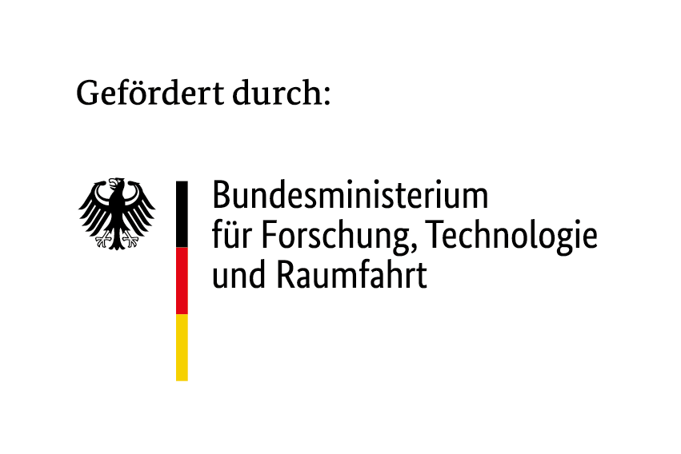

# Kontakt

!!! warning "Platzhalter"
    Die folgenden Angaben sind noch zu bestätigen: Projekt-E-Mail-Postfach,
    Anschrift des Konsortialführers und die für das Impressum verantwortliche Stelle.
    Siehe Klärungspunkte im Implementierungsplan.

## Konsortialkoordination

**Ruhr-Universität Bochum** (Verbundkoordinatorin)

*Fakultät für Elektrotechnik und Informationstechnik, Lehrstuhl für Embedded Security*
*Universitätsstraße 150, 44801 Bochum*

**E-Mail:** [steffen.becker@rub.de](mailto:steffen.becker@rub.de)

## Ansprechpersonen nach Thema

=== "Technik & PoCs"

    Fragen zu datenschutzkonformen AIaaS-Konfigurationen, Risiko-Profilen und
    Demonstratoren: Ruhr-Universität Bochum (RUB), Arbeitspaket 4.

=== "Kompetenzförderung & Mitarbeitende"

    Fragen zu Schulungsformaten, mentalen Modellen und Handreichungen:
    Universität Duisburg-Essen (UDE), Arbeitspakete 2 und 4.

=== "Prozesse & Organisationskultur"

    Fragen zu Einführungsprozessen, Best Practices und Entscheidungsbaum:
    Universität Witten/Herdecke (UWH), Arbeitspakete 3 und 4.

=== "Praxis & Region"

    Fragen zum Pilotbetrieb, zu Transfer-Workshops und zur Ansprache regionaler Akteure:
    WirtschaftsEntwicklungsGesellschaft Bochum mbH (BoWE).

## Für Presse und Multiplikator:innen

Wir stellen Materialien, Zitate und Vorträge zur Verfügung und sind auf Fachveranstaltungen
an der Schnittstelle von IT-Sicherheit, Psychologie und Arbeitswelt anschlussfähig.
Kontakt über die oben genannte Adresse.

## Förderung

**Gefördert durch:** Bundesministerium für Forschung, Technologie und Raumfahrt (BMFTR)

**Förderrichtlinie:** „Plattform Privatheit – IT-Sicherheit schützt Privatheit und stützt
Demokratie" („Digital.Sicher.Souverän")

**Förderkennzeichen:** 16KIS2669K

{ loading=lazy, width="250"  }

