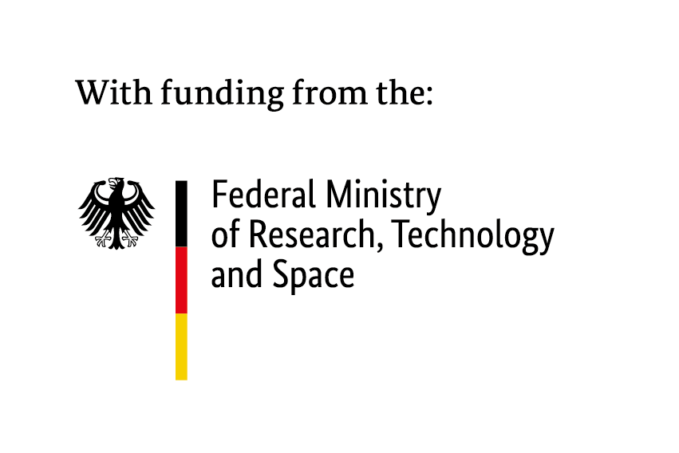

---
hide:
  - toc
---

<!--

-->

# DAISY

**Data Protection and Employee Interests in AI-as-a-Service Systems**

AI has become an important tool in many companies.  
DAISY aims to research service solutions that are
practical while minimizing privacy risks: technically, psychologically and
organizationally, tested in everyday business operations.

<!--

[Publications](publications.md){ .md-button .md-button--primary }
[Contact](team.md){ .md-button }

-->

## Project summary

Many companies use artificial intelligence as a service: employees query an internally
configured chatbot whose language model is operated in the cloud by a third-party provider.
This is cheap, fast,and requires hardly any in-house AI expertise. In other enterprises, an AI strategy might not even have been laid out yet and employees are using various unpoliced personal tools.

What remains open is what happens to employees' data, who bears responsibility and where
the limits of the system lie - especially when automating workflows with agentic tools. These risks are rarely intuitive for users and
decision-makers, as they differ significantly from the commercial chatbots people know
from their private lives.

DAISY starts exactly there. As a consortium of computer science, psychology and practice,
we develop IT security solutions, strengthen the competence of decision-makers and
employees, and shape the introduction of AI services in companies together in a participatory and
transparent way. The legal framework is taken into account from the very beginning.

## Latest news

[All news](news/index.md){ .md-button }

<!-- ## What sets DAISY apart -->

- :material-shield-lock:{ .lg .middle } __Secure technology__

    ---

    We build on open-source tools and test configurations that address typical privacy risks of AIaaS. Interactive demonstrators make them tangible.

- :material-brain:{ .lg .middle } __Sound insights__

    ---

    We investigate how employees and decision-makers understand AIaaS, and compare these
    mental models with the actual properties of the systems.

- :material-handshake:{ .lg .middle } __Practical processes__

    ---

    We develop evidence-based process models for a calibrated, employee-centered
    introduction of AI services, tailored to the organizational culture.

- :material-package-variant-closed:{ .lg .middle } __Free use__

    ---

    We make all results available under an open license and free of charge. No separate
    patent or property right applications are planned.

## Project information

--8<-- "docs/shared/partner-logos.html"

**Consortium coordination**
: Ruhr University Bochum (RUB)

**Scientific partners**
: Witten/Herdecke University (UW/H), University of Duisburg-Essen (UDE)

**Practice partner**
: WirtschaftsEntwicklungsGesellschaft Bochum mbH (BoWE)

**Region**
: Bochum and the Ruhr area, with nationwide impact

**Funding**

**Funded by:** Federal Ministry of Research, Technology and Space (BMFTR)

**Funding guideline:** "Plattform Privatheit – IT-Sicherheit schützt Privatheit und stützt
Demokratie" ("Digital.Sicher.Souverän")

**Funding window:** September 2026 to August 2029 (3 years) 

**Funding reference number:** 16KIS2669K

**Project funding sum:** 1.55 mio. € (of which 1.29 mio. is funded by BMFTR)

{ loading=lazy, width="250"  }

